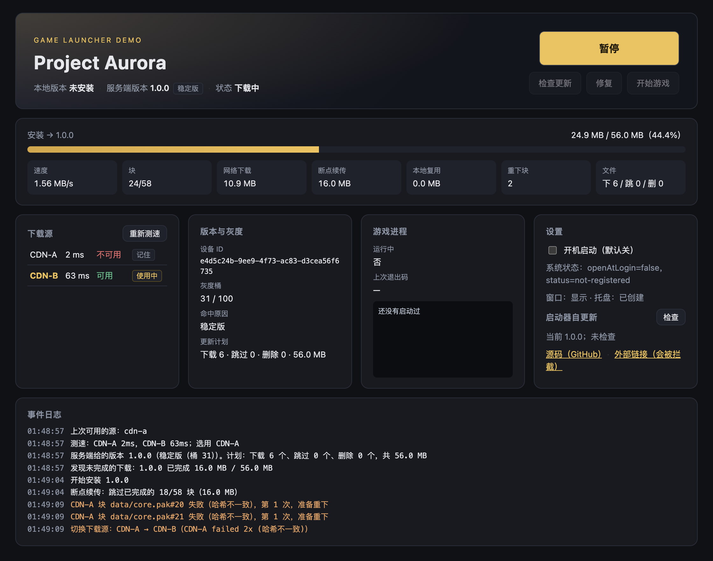
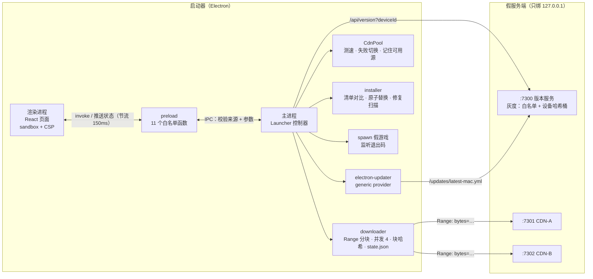
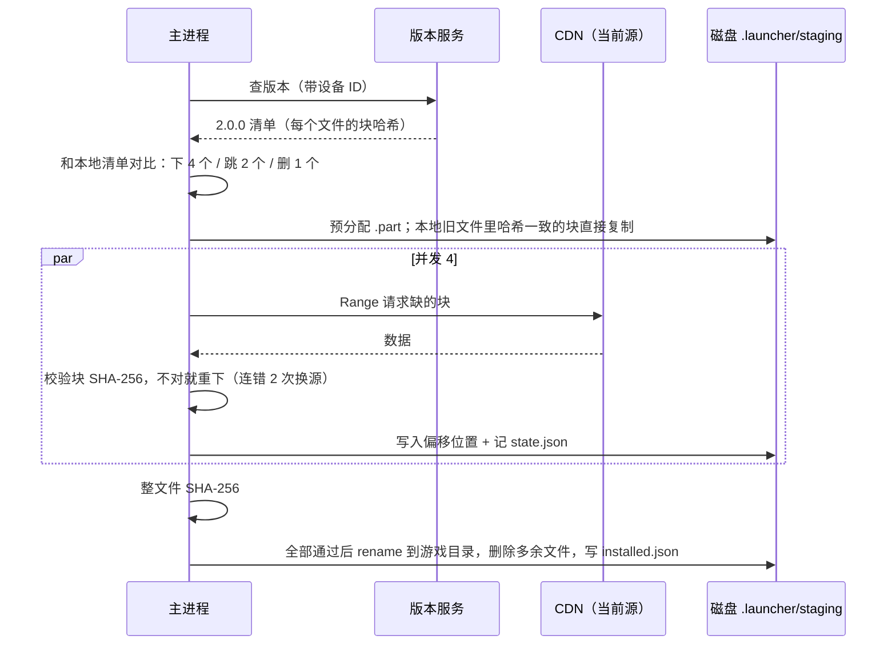
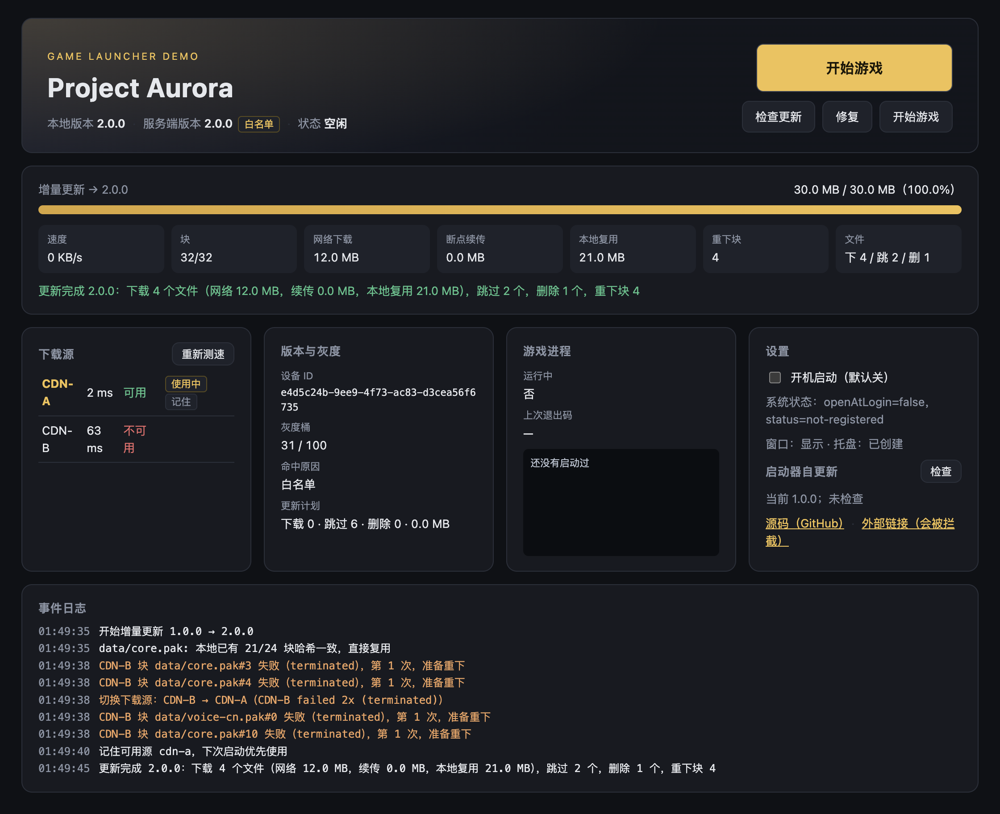
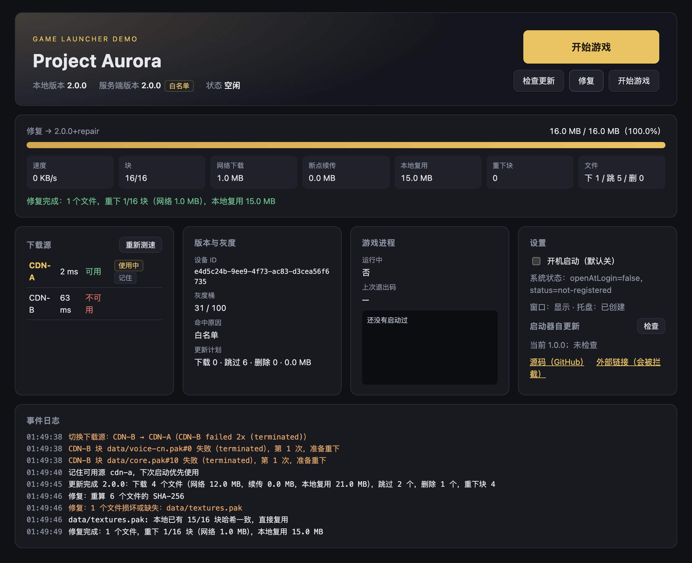

# Game Launcher Demo

一个用 Electron 写的 PC 游戏启动器 Demo：分块下载、断点续传、SHA-256 校验、多 CDN 切换、增量更新、文件修复、灰度发布，配一个本机假服务端，全部能在一台 Mac 上跑通。

A desktop game launcher demo (Electron + TypeScript + React) with chunked resumable downloads, per-chunk SHA-256 verification, multi-CDN failover, delta updates, repair and gray release, plus a local fake backend.

> **未签名**：没有 Apple 开发者证书，只做了 ad-hoc 签名。首次打开如果被拦，到「系统设置 → 隐私与安全性」点「仍要打开」。



## 架构



下载一次更新的过程：



## 功能

| 功能 | 怎么做的 | 代码 |
|---|---|---|
| 分块下载 | 1 MiB 一块，HTTP `Range`，并发上限 4，进度节流后推给页面 | `src/core/downloader.ts`、`src/core/limiter.ts`、`src/core/throttle.ts` |
| 断点续传 | 每写完一块就原子写 `state.json`；重开后跳过已完成的块 | `src/core/downloader.ts` |
| 校验 | 每块 SHA-256，坏块重下；全部写进 `.part` 临时文件，整文件校验通过才替换 | `src/core/downloader.ts`、`src/core/installer.ts` |
| 多 CDN | 启动测速选最快；连续失败 2 次冷却 30 秒并切源；成功的源写进设置，下次优先 | `src/core/cdn-pool.ts` |
| 增量更新 | 新旧清单按路径 + 哈希对比，只下变化的文件、删多余的；变化文件里没变的块从本地复制 | `src/core/manifest.ts`、`src/core/downloader.ts` |
| 修复 | 全量重算哈希，坏文件按块比对，只重下坏块 | `src/core/installer.ts` |
| 灰度 | `sha256(盐:设备ID) % 100 < 比例` 或命中白名单就给新版本；同一设备结果稳定，比例调高不会收回 | `src/core/gray.ts`、`server/index.ts` |
| 安全 | `contextIsolation`、`nodeIntegration: false`、`sandbox`；preload 白名单；主进程校验 `senderFrame.url` 和参数；`app://` 协议带 CSP 头；拦截跳转、新窗口、权限请求；远端清单校验路径防目录穿越 | `src/main/index.ts`、`src/core/ipc-guard.ts`、`src/preload/index.ts`、`src/core/manifest.ts` |
| 启动游戏 | 用 App 自己的二进制以 Node 模式 spawn 下载下来的 `game.js`，收日志和退出码；运行中拒绝更新和修复 | `src/main/game.ts`、`src/main/launcher.ts` |
| 托盘 / 开机启动 | 关窗口进菜单栏托盘；开机启动做成设置项，默认关 | `src/main/index.ts` |
| 自更新 | electron-updater generic provider 指向本机服务，只做检测 | `src/main/updater.ts` |
| 打包 | electron-builder 出 mac arm64 `.dmg` / `.zip` | `electron-builder.yml` |





## 本地运行

需要 Node 20+，在 macOS arm64 上验证过。

```bash
npm install
npm test                 # 61 个单测：分块、哈希、清单比对、灰度、IPC 校验、下载器
npm run server           # 起假服务端：:7300 版本服务，:7301 CDN-A，:7302 CDN-B（首次会生成约 86 MB 假游戏数据）
npm start                # 另开终端，开发模式运行启动器
npm run dist             # 打包到 release/
```

假服务端的故障注入（另开终端执行）：

```bash
# 让 CDN-A 超时 / 报 503 / 返回 2 个坏块 / 恢复
curl -XPOST localhost:7300/admin/cdn/cdn-a -d '{"mode":"timeout"}'
curl -XPOST localhost:7300/admin/cdn/cdn-a -d '{"mode":"error"}'
curl -XPOST localhost:7300/admin/cdn/cdn-a -d '{"mode":"corrupt","corruptCount":2}'
curl -XPOST localhost:7300/admin/cdn/cdn-a -d '{"mode":"ok"}'
# 限速（每个连接 KB/s），让下载慢到能中途打断
curl -XPOST localhost:7300/admin/cdn/cdn-a -d '{"rateKBps":384}'
# 灰度：按比例，或把设备 ID（页面上能看到）加白名单
curl -XPOST localhost:7300/admin/gray -d '{"percent":20}'
curl -XPOST localhost:7300/admin/gray -d '{"whitelist":["<设备ID>"]}'
# 看各 CDN 实际发出的字节数
curl localhost:7300/admin/state
```

## 已知限制

- 未签名、未公证；自更新只做到「检测到新版本」，下载安装需要签名包。
- 托盘图标在菜单栏里的样子没有截图（验收环境截不到屏幕），只验证了关窗口后进程还在、窗口隐藏、再次启动能把窗口叫回来。
- 游戏进程是一个 Node 脚本，不是真正的游戏。

## License

MIT
